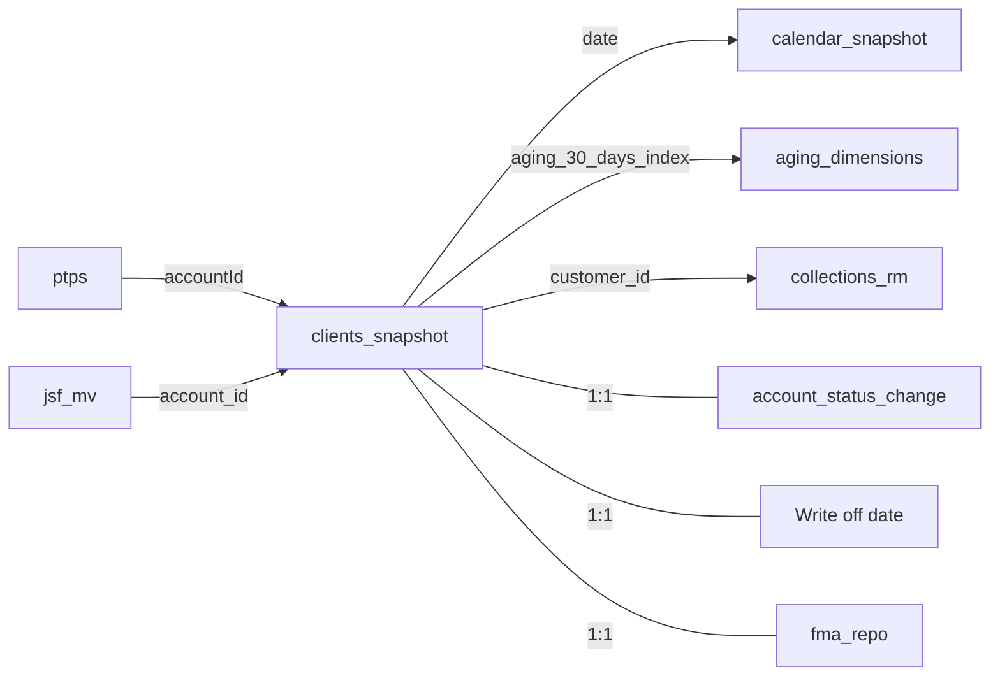
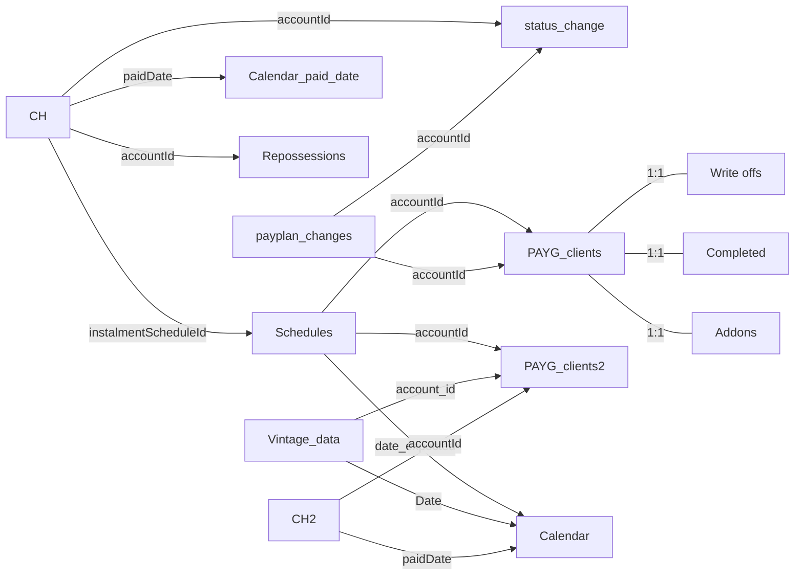

# PAYG Dashboard – Ke (consolidated prototype)

**Status:** prototype, built 2026-10-21. It has not been refreshed or published yet. See *Before using it* below.

This project merges **PAYG Analysis** and **PAYG Overview** (Kenya) into one Power BI project. The calculation logic is copied unchanged from the two original files; the changes are listed below. It follows the plan in [`../payg_v1/review/2026-10-21_payg-dashboards-ke_review.md`](../payg_v1/review/2026-10-21_payg-dashboards-ke_review.md) (items 6, 7, 12 and part of 3.1).

| | |
|---|---|
| Owner | BI team (TBC) |
| Audience | Credit, collections, sales management |
| Data sources | Power BI dataflows in workspace `6b82f3d7…`: `accounts_mv`, `installment_payments`, `installment_schedules`, `account_status_change`, `ptps`, `jsf_mv`, `fma_repo`, `mart_cds_responses`, `account_devices`, `vw_payplan_changes` |
| Refresh | TBC (the two originals refresh separately today) |
| Workspace | not published |

## Pages

| Section | Pages | From |
|---|---|---|
| Portfolio (snapshot of today's balances) | Overview, PAYG Analysis, PAYG Clients, Written Off Clients, Late PAYG Analysis, RM Performance Matrix, Sales Agent Performance Matrix, FPD, Summary, PTP Details, Turaco Clients | PAYG Analysis |
| Vintage (month-end cohorts) | Churn Rates, Add-ons comparison | PAYG Overview |

**Not carried over:**
- **PTP**: hidden in the original, and its measures could not calculate (they need a `payments` table that is no longer in the model).
- **CRB Report**: shows national ID, DOB and income. It should move to a separate, restricted report.

## Two definitions, both kept and labelled

The two original reports calculate some metrics differently. Until the metric owner picks one definition, both are kept, and the name says which one it is. Each measure's description holds its definition.

| Snapshot (from PAYG Analysis) | Vintage (from PAYG Overview) |
|---|---|
| `% PAR30 (snapshot)`, `% PAR30 (snapshot, active statuses)`, `% PAR30 (snapshot, days since last payment)` | `% PAR15 (vintage)`, `% PAR30 (vintage)`, `% PAR60 (vintage)`, `% PAR90 (vintage)`, `% PAR120 (vintage)` |
| `% Arrears (snapshot)`: arrears2 / balance | `% At Risk (vintage)`: rebuilt arrears / month-end balance |
| FPD: `%fpd_accounts`, `%fpd_balance` (paid < 1 installment, status Arrears, arrears2 > 0) | (the vintage FPD column was unused and has been removed; definition was months_in_book = 1 and arrears > 10) |

Snapshot PAR60 and PAR90 existed in PAYG Analysis but no page used them, so the optimisation pass removed them.

The snapshot pages use the `clients_snapshot` table (the original Analysis `payg_clients`). The vintage pages use `PAYG_clients`, `Schedules`, `CH` and `Vintage_data`. The two sides share no tables, so filters on one side don't affect the other, just as with the two separate reports.

## Data Models

One semantic model (`PAYG Dashboard - Ke.SemanticModel`, Import mode) holding **two independent groups of tables**. The groups share no tables and no relationships, so a filter on one side never reaches the other. That is how the two original reports behaved, and it is why both metric definitions above can coexist.

| | Snapshot side | Vintage side |
|---|---|---|
| Question it answers | Where does the book stand today? | How do cohorts behave month by month? |
| Main table | `clients_snapshot` (one row per account) | `Vintage_data` (one row per account per month-end) |
| Pages | Overview … Turaco Clients (11) | Churn Rates, Add-ons comparison (2) |
| Measures | 24 (`clients_snapshot`, `basic_measures`) | 10 (`Vintage_data`) |

Model size: 26 tables, 34 measures, 25 relationships, no auto-date tables. All sources are Power BI dataflows in workspace `6b82f3d7…`. Row counts will be added after the next refresh.

### Snapshot side

| Table | Type | Source | Grain | Notes |
|---|---|---|---|---|
| `clients_snapshot` | Fact | dataflow `accounts_mv` | One row per Kenya PAYG account | Filtered to PAYG + Kenya and de-duplicated on `account_id` in Power Query. 100 columns, of which 51 are DAX calculated columns (balance, arrears2, aging buckets, FPD flag, status_change…). Was `payg_clients` in PAYG Analysis. |
| `calendar_snapshot` | Date | DAX `CALENDAR` | One row per day, first payment date → today | Not marked as a date table. Was `calendar`. |
| `aging_dimensions` | Lookup | DAX `DATATABLE` | 9 aging buckets | Sort order for aging visuals. |
| `collections_rm` | Lookup | DAX `SUMMARIZE` over `clients_snapshot` | One row per customer | Assigns a relationship manager and station by region and `MOD(customer_id)`; staff names are typed into the DAX (review item 14). |
| `basic_measures` | Measures | DAX `{BLANK()}` | — | Holds 14 measures (FPD, client counts, balance). |
| `ptps` | Fact | dataflow `ptps` | One row per promise-to-pay | Used by *PTP Details* and the latest-PTP columns on `clients_snapshot`. All countries; filtered through the relationship. |
| `account_status_change` | Lookup | dataflow `account_status_change` | One row per account | Used by `clients_snapshot[status_change]`. |
| `Write off date` | Lookup | dataflow `account_status_change`, write-offs only | One row per written-off account | Feeds `clients_snapshot[write_off_date]`. |
| `fma_repo` | Lookup | dataflow `fma_repo`, open repossession tasks | One row per account | Feeds `Hybrid Type`. |
| `jsf_mv` | Lookup | dataflow `jsf_mv`, trimmed to 4 columns | One row per job sheet | Feeds `Engineer Name`. |

### Vintage side

| Table | Type | Source | Grain | Notes |
|---|---|---|---|---|
| `PAYG_clients` | Dimension | dataflow `accounts_mv` | One row per Kenya PAYG account with a payment | Excludes refunded/rejected, missing product or installment date, and the 5 named test/staff accounts. Write-off, completion and repossession dates are merged in from the status tables. |
| `CH` | Fact | dataflow `installment_payments` | One row per payment allocated to an installment | Limited to accounts in `PAYG_clients` (inner join). 11 calculated columns (paid on time / early / late, running totals). |
| `CH2` | Fact (copy) | DAX `SELECTCOLUMNS(CH, …)` | Same as `CH` | A narrower copy of `CH` related to `PAYG_clients2`. Candidate for removal once visuals point at `CH`. |
| `Schedules` | Fact | dataflow `installment_schedules` | One row per expected installment | Filtered by merging with `PAYG_clients`. 1 calculated column (`date_expected`); the aging, retention, attrition and reactivation columns were removed with their pages. |
| `Vintage_data` | Fact | DAX `CROSSJOIN(PAYG_clients2, Calendar_vd)` | One row per account per month-end, from the installment month up to 60 months | 23 calculated columns: cumulative expected/paid, balances, days in arrears, churn. **The heaviest table; it drives refresh time.** |
| `PAYG_clients2` | Dimension | DAX `SUMMARIZE(PAYG_clients)` | One row per account | Account attributes for `Vintage_data`, `Schedules` and `CH2`, plus disbursement month and a 60-month cut-off date for the vintage grid. |
| `Monthly_collected` | Aggregate | DAX `SUMMARIZE(CH)` | One row per paid date × region | Daily collections. |
| `status_change` | Lookup | dataflow `account_status_change` | One row per status change | Latest status date per account, used in `Schedules` and `Vintage_data`. |
| `Write offs`, `Completed`, `Repossessions` | Lookup | dataflow `account_status_change`, one status each | One row per account | Also merged into `PAYG_clients` in Power Query. |
| `Addons`, `payplan_changes` | Lookup | dataflows `accounts_mv` (add-ons only), `vw_payplan_changes` | Per add-on account / per plan change | Add-on product and date for the *Add-ons comparison* page. |
| `Calendar`, `Calendar_paid_date` | Date | Power Query calendar template, 2017–2030 | One row per day | Two copies of the same pasted template; not marked as date tables. |
| `Calendar_vd` | Date | DAX | One row per month-end since 2017 | Builds the `Vintage_data` grid. |

### Relationships

25 relationships between model tables. All are single-direction many-to-one, except those flagged here:

| Relationship | Direction | Why it matters |
|---|---|---|
| `clients_snapshot[date]` → `calendar_snapshot[Date]` | **both** | Main date link on the snapshot side; filters flow back from facts to the calendar |
| `clients_snapshot[aging_30_days_index]` → `aging_dimensions[Index]` | **both** | |
| `ptps[accountId]` → `clients_snapshot[account_id]` | **both** | Lets PTP filters narrow the client list |
| `clients_snapshot` ↔ `account_status_change` / `Write off date` / `fma_repo` | **both, 1:1** | Could be merged into `clients_snapshot` upstream |
| `PAYG_clients` ↔ `Write offs` / `Completed` / `Addons` | **both, 1:1** | Same |
| `Calendar[Date]` ↔ `Calendar_paid_date[Date]` | both, 1:1, **inactive** | Not used by default |

Auto date/time is **off** and the model has no `LocalDateTable_…` tables. The 7 DAX expressions that used `.[Date]` were rewritten as plain DAX with the same result (date part of a value, blanks kept blank; `DATEDIFF(…, DAY)` unchanged because it counts day boundaries). Visuals that used date hierarchies now use real columns: the Overview chart uses `calendar_snapshot` Year → Quarter → Month → Date; the *Turaco Clients* slicer and line chart use `sale_date`; two new columns, `clients_snapshot[Sale Year]` and `ptps[Created Year]`, replace the Year level on *FPD Rates* and *PTP Details*.

### Power Query load order

Some queries read from others, so they cannot be split across models without moving the logic upstream:

- `clients_snapshot` ← `amtdb account_devices` (shared expression: device ID per account)
- `PAYG_clients` ← `Write offs`, `Completed`, `Repossessions` (status dates)
- `Schedules` ← `PAYG_clients` (6 columns used to filter schedules to valid accounts)
- `CH` ← `PAYG_clients` (keeps Kenya PAYG payments only)

## What changed from the originals

| Change | Why | Effect on numbers |
|---|---|---|
| Kenya filter added in Power Query to `clients_snapshot` and `PAYG_clients`; `CH` (payments) limited to accounts in `PAYG_clients` | The originals loaded every country and filtered in the report | None expected: the report filters already limited visuals to Kenya |
| Removed unused tables: `Credit History`, `installment_payments` (duplicate), the IoT DirectQuery tables, 5 unused calendars and lookup tables, `credit_unit_economics` | Nothing used them | None |
| Auto date/time turned off; no auto-date tables (was ~234 across the two files); `.[Date]` DAX rewritten and date-hierarchy visuals pointed at real columns (see *Relationships*) | Size; Desktop drops auto-date hierarchies when the setting is off, which broke *Churn Rates* on the first refresh | None |
| `jsf_mv[account_id]` cast to text in Power Query, and `Engineer Name` compares account IDs as text | On refresh the dataflow returned a whole number, which broke the *PAYG Clients* table | None |
| `jsf_mv` trimmed to the 4 columns used | Size | None |
| Removed objects in error: 7 `ptps` columns and 5 PTP/dispatch measures that depended on missing tables; `PAYG_clients[Discount Name]` (missing `discount_notes`); `% At Risk` (exact duplicate of `% Arrears`) | They could not calculate | None (they returned errors) |
| Removed broken references: filters on `collections[collection_id]` (*PTP Details*) and `expected_first_payment_year_month` (*FPD Rates*); next-of-kin fields that no longer exist (*Turaco Clients*) | They pointed at fields that no longer exist | None |
| Fixed 2 bookmarks that filtered on `company_region` instead of `companyRegion` | Their Kenya filter did nothing | None (the report-level Kenya filter already applies) |
| Renamed tables: `payg_clients` → `clients_snapshot`, `calendar` → `calendar_snapshot` | Both reports had tables with these names | None |
| Embedded custom visuals removed (heatmap, vdt) | Unused, ~10 MB | None |
| **Optimisation pass:** removed 80 measures, 147 calculated columns, 497 data columns, 3 user hierarchies, the remaining auto-date tables and 6 tables (`mart_cds_responses`, `aging_start`, `aging_end`, `sch`, `PAYG_clients3`, `Calendar_schedule_paid_date`) that no page, filter, bookmark or remaining calculation uses. Each Power Query table now ends with a *Columns used by the report* step, so only the needed columns load. | Size and refresh time | None: every field the report uses, and everything those fields depend on, is kept |

**Model after optimisation:** 26 tables, 34 measures, 25 relationships. Two checks passed: every report field resolves, and the model compiles with no errors in the Power BI engine.

## Layout and theme

Applied to all pages (22 at the time; 15 now), following [`_templates/BRAND.md`](../../../_templates/BRAND.md) and [`STANDARDS.md`](../../../_templates/STANDARDS.md):

- **Theme:** `SunCulture.json` (colour-blind-tested chart palette, Arial, `#F5F6F4` page background, white cards with no border or shadow). Literal per-visual fonts and colours were removed so the theme applies. Conditional formatting, queries and visual-level filters are unchanged.
- **Header on every page:** SunCulture logo and accent line, page title, subtitle (`Kenya · PAYG · Portfolio snapshot` or `… · Vintage (month-end cohorts)`), and a *Data refreshed* card. The old upper-case title banners and the separate refresh card on Overview were replaced.
- **Canvas:** 1280 wide on every page (was 8 different sizes, up to 1650 wide). Long pages scroll vertically.
- **Filters:** at most 6 slicers per page, in one row under the header, ranked dates → region → county → product → status → RM/agent. **44 lower-priority slicers moved to the filter pane** as page filters (account ref, customer name, town, device ID, tranche, days late, …). The filter pane was hidden report-wide; it is now visible. No slicer had a saved selection, so moving them changes no numbers.
- **Vintage pages** keep their left-hand menu and tab buttons, scaled to the new width.
- **Lone score cards removed** from the top of the snapshot detail pages (PAYG Clients, Written Off Clients, Late PAYG Analysis, RM Performance, FPD Accounts, Summary, PTP Details, Turaco Clients), plus two cards on Overview that sat below the old canvas edge and were never visible.
- **Vintage menu removed** (2026-10-22) from all 9 Vintage pages; their content now spans the full width. The 8 pages that were only reachable from the menu are no longer hidden and appear as normal page tabs. The *<30 / <60 / <90* tab buttons on the Retention and Attrition pages are kept; 6 of the 10 bookmarks are still used by them, and the other 4 (menu only) are left for review.
- **Gaps closed:** after slicers moved out, each visual moves up until it meets the one above it (labels laid over buttons move with their button).
- **Titles:** "Chart 1:" / "Table 2:" prefixes removed. Bars coloured by their value (gradients) now use the theme colour, per `BRAND.md`. KPI card values set to 18 pt so they fit.

### Pages removed (2026-10-22)

The team removed 7 Vintage pages: *Retention Rates*, *60/90 Retention Rates*, *Attrition Rates*, *60/90 Attrition Rates* and *Reactivation Rates*. The bookmarks that opened them and 3 stale bookmarks that pointed at pages no longer in the report were deleted (the report now has no bookmarks). A further optimisation pass then removed what only those pages used: 7 measures (the retention, attrition and reactivation rates), 27 calculated columns and 9 data columns. The model compiles with no errors (26 tables, 34 measures, 25 relationships) and is stored as TMDL.

### FPD pages merged (2026-10-22)

*FPD Rates*, *FPD Summary* and *FPD Accounts* are now one page, **FPD** (*First payment default*), in three sections: rates, balances, accounts. One slicer row (Sale Year, Region, County, Product, Status, Sales Agent); the other slicer fields are in the filter pane. Visuals that shared a title were renamed ("FPD rate by region" vs "FPD balance by region").

Every visual keeps the filters it had on its old page: `total_payment > 0` (on all three pages) stays a page filter; `month_before = Yes` (Rates and Summary only) moved onto those 9 visuals; `fpd_client = 1` (Accounts only) moved onto the accounts table. Without this, the accounts-only filter would have pushed every FPD rate towards 100%. Slicers now filter all three sections at once, where before each slicer only filtered its own page. The report has 13 pages.

## Not done yet (deliberately)

- **Logic is still in DAX.** `Vintage_data` and `Schedules` still compute row by row, so refresh will still be slow. Next step: move them into pipeline tables (review item 13).
- **Visual titles and chart choices are unchanged.** Untitled visuals show Power BI's automatic titles, and pie/donut and combo charts are as in the originals.
- **Relationships are unchanged**, including the bidirectional ones on the snapshot side.
- **No RLS yet**, and the client-detail pages still show personal data.

## Before using it

1. **Open in Power BI Desktop** (File → Open → `PAYG Dashboard - Ke.pbip`). Sign in to the dataflows if prompted, then click **Refresh**.
2. **Check that it loaded.** `clients_snapshot`, `PAYG_clients` and `CH` should hold only Kenya rows, and none should be empty.
3. **Compare headline numbers** with the published PAYG Analysis and PAYG Overview: PAYG clients, balance, arrears, PAR30 (both versions), churn rate. Small differences are expected only where the original data is from an older refresh.
4. **Save in Desktop.** If *Store semantic model using TMDL format* is enabled, Desktop converts `model.bim` to TMDL files. Then commit.
5. **Publish to a dev workspace first**, not over the existing reports.
